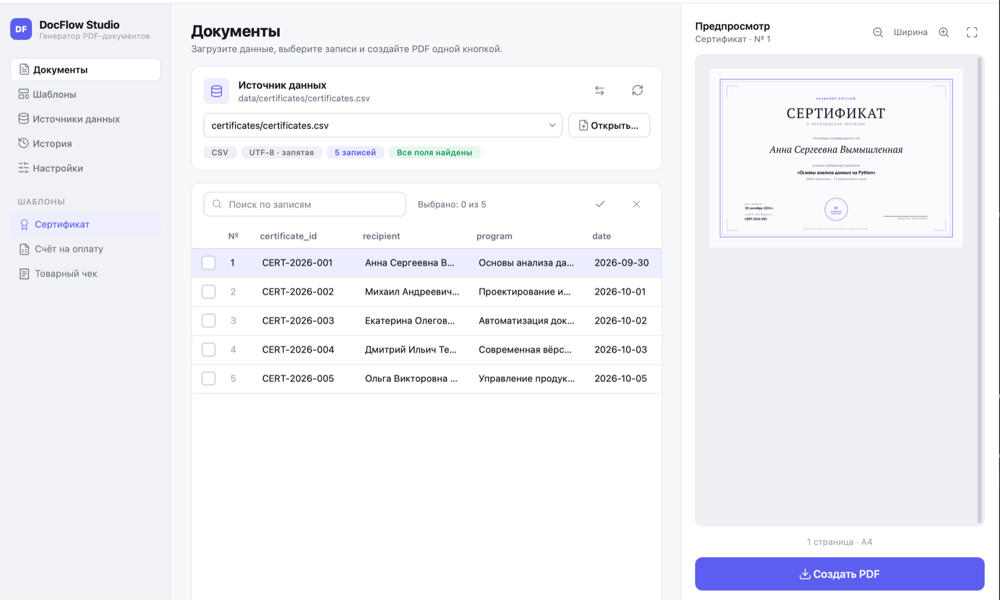
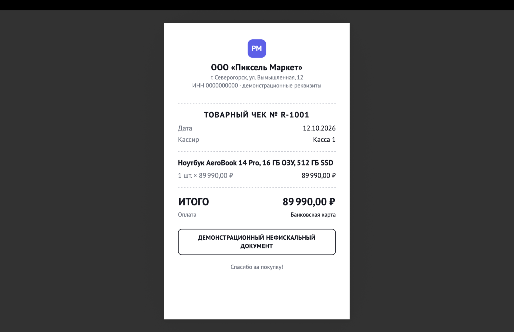
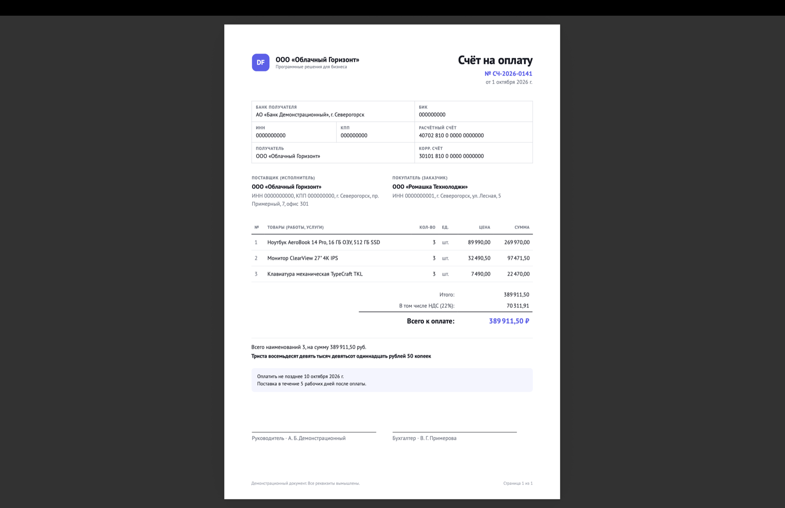
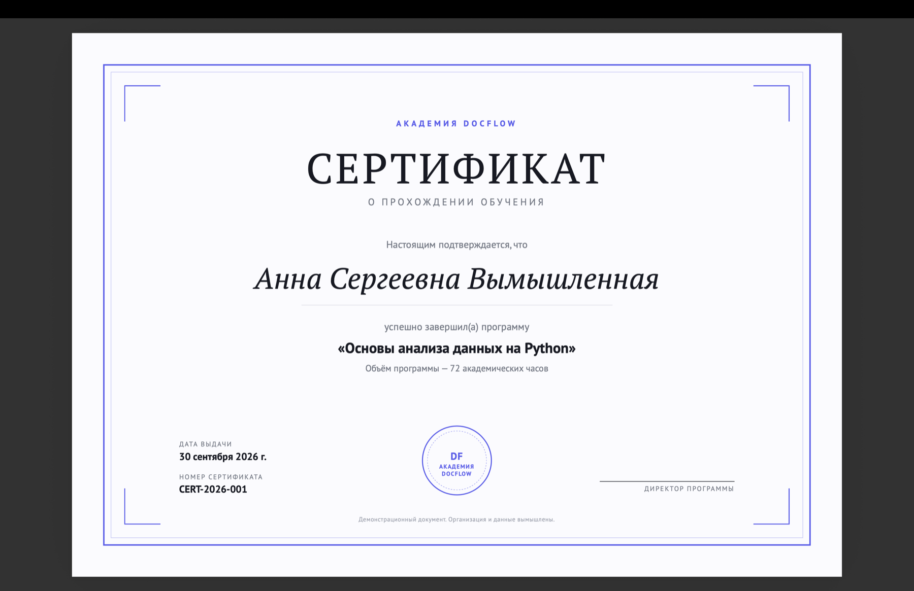

# DocFlow Studio



<table>
  <tr>
    <td align="center" width="33%"><br>Товарный чек</td>
    <td align="center" width="33%"><br>Счёт на оплату</td>
    <td align="center" width="33%"><br>Сертификат</td>
  </tr>
</table>

Настольное приложение для macOS, которое превращает CSV и JSON в аккуратные
PDF-документы по HTML-шаблонам. Всё работает локально: без серверов, облаков и
сетевых запросов.

- Три рабочие области: разделы и шаблоны слева, таблица данных в центре,
  настоящий PDF-предпросмотр справа с масштабированием.
- Светлая и тёмная темы, системный шрифт macOS, все надписи на русском.
- Пакетная генерация, сопоставление полей, история операций, недавние файлы.
- Консольный режим с тем же ядром генерации.

Демонстрационные шаблоны: **товарный чек** (лента 80 мм), **счёт на оплату**
(A4, многостраничный, НДС) и **сертификат** (A4, альбомная ориентация).

## Установка на macOS

Нужны Python 3.10 или новее и [Homebrew](https://brew.sh).

```bash
# 1. Системные библиотеки для WeasyPrint
brew install pango

# 2. Виртуальное окружение и зависимости
cd "путь/к/папке/проекта"
python3 -m venv .venv
source .venv/bin/activate
pip install -r requirements.txt
```

> Ставятся только нужные части Qt (`PySide6-Essentials` и `PySide6-Pdf`),
> без тяжёлого WebEngine. Для PySide6 версий до 6.12 вместо `PySide6-Pdf`
> установите `PySide6-Addons`.

## Запуск

```bash
source .venv/bin/activate

python3 main.py          # графический интерфейс
python3 main.py --cli    # консольное меню
```

## Как создать документ в приложении

1. Слева в списке **«Шаблоны»** выберите шаблон, например «Товарный чек».
2. В блоке **«Источник данных»** выберите файл из списка (например,
   `receipts/receipts.csv`) или нажмите **«Открыть…»** и укажите CSV или JSON
   на компьютере (сочетание клавиш ⌘O).
3. Щёлкните строку таблицы — справа появится настоящий PDF этой записи.
   Масштаб меняется кнопками над предпросмотром или ⌘+ / ⌘−.
4. Отметьте флажками нужные записи или нажмите **«Выбрать все»**. Если ничего не
   отмечено, документ создаётся для текущей строки. Поиск сужает список.
5. Нажмите **«Создать PDF»** (или ⌘↩). Один документ откроется автоматически,
   для нескольких появится кнопка «Открыть папку».

Готовые файлы сохраняются в `output/`. Существующие файлы никогда не
перезаписываются: имя содержит метку записи и время, а при совпадении
добавляется `-2`, `-3`… На печать ничего не отправляется.

## Консольный режим

```
python3 main.py --cli

  1  Выбрать шаблон
  2  Выбрать данные
  3  Выбрать запись
  4  Создать PDF
  5  Создать PDF для всех записей
  6  Открыть результат
  7  Выход
```

Без меню, одной командой (удобно для скриптов):

```bash
# Записи 1 и 3–5
python3 main.py --template receipt --data data/receipts/receipts.csv --record 1,3-5

# Все записи, в свою папку, без автооткрытия
python3 main.py --template invoice --data data/invoices/invoices.json --all \
    --output ~/Documents/Счета --no-open
```

`--template` принимает id (имя файла без `.html`), имя файла или путь.

## Загрузка CSV и JSON

**CSV.** Первая строка — заголовки колонок. Поддерживаются UTF-8, UTF-8 с BOM
и Windows-1251 (определяются автоматически), разделители `,` `;` табуляция и
`|`. Числа можно записывать как `1234.50`, `1 234,50` или `1234,50 ₽`.

```csv
id,product,price,qty
R-1001,"Ноутбук AeroBook 14 Pro, 16 ГБ ОЗУ",89990.00,1
```

**JSON.** Список объектов или объект с ключом `records` / `items` / `data`.
Вложенные списки (например, позиции счёта) поддерживаются:

```json
{"records": [
  {"number": "СЧ-1", "date": "2026-10-01", "vat_rate": 20,
   "client": {"name": "ООО «Пример»"},
   "items": [{"product": "Монитор", "qty": 2, "price": "32490.50"}]}
]}
```

**Если файл не подходит к шаблону** (например, сертификат и таблица чеков),
приложение так и скажет и предложит подходящие файлы из папок проекта. При
выборе шаблона подходящий файл открывается автоматически.

Программа проверяет типы: если в поле даты попал текст или в поле позиций —
одно значение, документ не создаётся, а в сообщении указано, что исправить.

**Если колонки называются иначе**, чем поля шаблона (например, `Товар` вместо
`product`), приложение попробует сопоставить их само, а если не получится —
нажмите **«Сопоставить поля»** и выберите колонки вручную. Выбор запоминается
для пары «шаблон + файл». В консоли программа спросит соответствие сама.

**Свои папки.** Раздел **«Источники данных» → «Добавить папку»**. Программа
ищет файлы только в `data/`, `templates/` проекта и в добавленных папках —
остальной компьютер не сканируется.

## Как добавить свой шаблон

Положите HTML-файл в `templates/` (или в добавленную папку) и нажмите
«Обновить» в разделе «Шаблоны».

```html
<!DOCTYPE html>
<html lang="ru">
<head>
<meta charset="utf-8">
<title>Акт</title>
<!-- docflow
name: Акт выполненных работ
description: A4, одна страница
icon: invoice          (receipt | invoice | certificate | file)
page: a4               (a4 | receipt)
required: number, client, total   (необязательно)
-->
<style>
  @page { size: A4; margin: 20mm; }
  body { font-family: "PT Sans", "Helvetica Neue", Arial, sans-serif; }
</style>
</head>
<body>
  <h1>Акт № {{ number }} от {{ date|date_long }}</h1>
  <p>Заказчик: {{ client }}</p>
  
    <p>{{ loop.index }}. {{ item.product }} — {{ item.total|money }}</p>
  
  <p>{{ comment }}</p>
  <p>Итого: {{ total|money }}</p>
</body>
</html>
```

| Конструкция | Что делает |
|---|---|
| `{{ поле }}`, `{{ client.name }}` | подставляет значение (всегда экранируется) |
| `…` | повторяет блок; внутри доступен `loop.index` |
| `……` | показывает блок, если поле заполнено |
| `money`, `number`, `date`, `date_long` | 1 234,50 ₽ · 1 234,5 · 01.10.2026 · 1 октября 2026 г. |
| `in_words` | сумма прописью |
| `default:"текст"`, `upper`, `lower`, `capitalize`, `count` | значение по умолчанию и преобразования |

Вычисляются автоматически (на `Decimal`): `total = price × qty` для записи или
позиции, а для списка `items` — `subtotal` (строка «Итого»), `vat`, `total`
(«Всего к оплате»), `items_count`. Также доступна `today` — сегодняшняя дата.

НДС считается так, как принято в российских счетах: цены уже включают налог, и
в счёте выводится «В том числе НДС (22%)». Если в данных указать
`"vat_included": false`, налог начисляется сверху. Без `vat_rate` выводится
«Без налога (НДС)». Фильтр `in_words` печатает сумму прописью: «Триста
восемьдесят девять тысяч девятьсот одиннадцать рублей 50 копеек».

Счёт можно собрать и из простой таблицы: если в CSV нет списка `items`, но есть
колонки товара и цены, получится счёт с одной позицией.

Ограничения ради безопасности: шаблон не может выполнять код, вызывать функции
или загружать что-либо из интернета. Картинки и стили можно подключать только
из папки шаблона (или через `data:`).

## Где хранятся данные

| Что | Где |
|---|---|
| Готовые PDF | `output/` (меняется в «Настройках») |
| Настройки, недавние файлы, сопоставления | `~/Library/Application Support/DocFlow Studio/settings.json` |
| История операций | `~/Library/Application Support/DocFlow Studio/history.sqlite3` |

В историю и журналы не попадают значения из ваших файлов — только имя шаблона,
имя файла данных, количество документов и статус.

## Тесты

```bash
source .venv/bin/activate
python -m pytest -q
```

Тесты создают реальные PDF во временной папке и проверяют их содержимое:
кириллицу, суммы, НДС, размеры страниц, многостраничность, уникальность имён,
блокировку сетевых ресурсов, CLI.

## Структура проекта

```
main.py            точка входа (GUI / --cli)
docflow/core/      независимое ядро: данные, шаблоны, расчёты, PDF, история
docflow/cli.py     консольный режим
docflow/ui/        интерфейс на PySide6
templates/         HTML-шаблоны
data/              демонстрационные CSV и JSON (вымышленные данные)
output/            готовые PDF (в Git не попадают)
tests/             pytest
docs/              архитектура и исходное задание
```

Подробнее — в [docs/ARCHITECTURE.md](docs/ARCHITECTURE.md).

## Лицензии компонентов

Иконки нарисованы в стиле [Lucide](https://lucide.dev) (лицензия ISC).
PySide6 — LGPLv3, WeasyPrint — BSD. Все организации, реквизиты и люди в
демонстрационных данных вымышлены.
