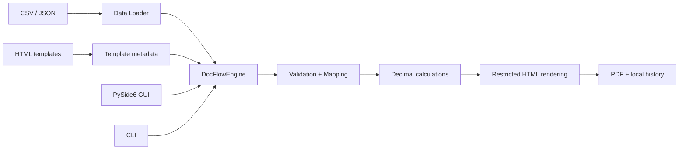

# DocFlow Studio — кейс для портфолио разработчика

> **Статус:** публичное настольное приложение; возможности описаны по исходному коду и документации репозитория. Повторный запуск тестов в рамках подготовки этого кейса не выполнялся.

## Задача

Компании получают табличные данные в CSV/JSON, а документы — счета, товарные чеки и сертификаты — оформляют в PDF. Ручной перенос данных в шаблоны создаёт повторяющиеся операции, риск ошибок и необходимость проверять каждую версию документа.

**Цель проекта:** локальное приложение для macOS, которое позволяет проверять исходные данные, применять шаблоны, просматривать итоговый PDF и генерировать документы пакетно. Облачные сервисы и LLM для работы приложения не нужны.

## Решение

- **GUI + CLI:** единое ядро `DocFlowEngine` обслуживает графический интерфейс и командную строку.
- **Вход:** CSV/JSON, поддержка различных кодировок и разделителей, сопоставление названий полей.
- **Проверка:** типы данных и обязательные поля валидируются до генерации.
- **Расчёты:** `Decimal` вместо двоичной арифметики с плавающей точкой для денежных сумм.
- **Шаблоны:** контролируемый синтаксис HTML-шаблонов с экранированием значений.
- **Выход:** PDF через WeasyPrint; резервирование имён без перезаписи существующих файлов.
- **История:** локальная SQLite; данные остаются на компьютере.

## Архитектура



Технические детали и ограничения: [ARCHITECTURE.md](ARCHITECTURE.md).

## Демонстрация за 2–3 минуты

1. Открыть `python3 main.py` на macOS.
2. Выбрать шаблон «Счёт» и тестовый JSON из `data/invoices/`.
3. Продемонстрировать отображение нескольких позиций, расчёт сумм и предварительный просмотр.
4. Создать PDF и показать результат в `output/`.
5. Ввести неверный тип поля, показать сообщение валидации вместо некорректного документа.
6. Запустить пакетную генерацию и убедиться, что существующие файлы не перезаписываются.

В репозитории есть [скриншот приложения](../screenshots/main-window.png) и [примеры документов](../screenshots/invoice.png).

## Что проверять по исходникам

| Требование | Где смотреть |
|---|---|
| Единое ядро GUI и CLI | `docflow/core/engine.py`, `docflow/cli.py` |
| Проверка данных и полей | `docflow/core/data_loader.py`, `docflow/core/templates.py` |
| Денежные расчёты | `docflow/core/calculations.py`, `docflow/core/money.py` |
| Запрет сетевых запросов при рендеринге | `docflow/core/renderer.py` |
| Генерация PDF и защита от перезаписи | `docflow/core/naming.py`, `tests/test_generation.py` |
| Графический интерфейс | `docflow/ui/` |

## Проверка и ограничения

```bash
python3 -m venv .venv
source .venv/bin/activate
pip install -r requirements.txt
pytest -q
```

Для PDF-тестов на macOS может потребоваться системная библиотека Pango (`brew install pango`). **Не считайте пропущенные тесты успешными:** проверяйте статус `skip` в отчёте pytest.

Реальные интеграции с 1С/CRM, серверный API и автоматическое извлечение данных из входящих неструктурированных документов **не реализованы**. Приложение не является ИИ-агентом. Для хакатона оно демонстрирует отдельно стоящие компетенции: структурирование проекта, валидацию, обработку документов и тестируемую архитектуру.

## Ссылки

- [README и запуск](../README.md)
- [Схема архитектуры](ARCHITECTURE.md)
- [Тесты](../tests/)
